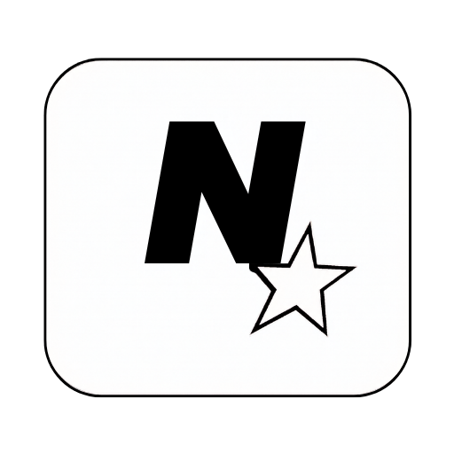

<div align="center">
  <!-- Specifying height="100" preserves the 486x384 aspect ratio perfectly -->
  
  <h1>NeoGen GUI</h1>
  <p>Open-Source GUI Toolkit for modding GTA V PS4</p>
  <p>
    <a href="LICENSE"></a>
    <a href="https://github.com/VansOnV/NeoGen/releases"></a>
    <a href="https://github.com/VansOnV/NeoGen/stargazers"></a>
    
  </p>
  <p>
    <a href="https://discord.gg/buC9W643tQ"></a>
    <a href="https://discord.gg/wtqeujmEdf"></a>
  </p>
  <p>
    <a href="#about">About</a> ·
    <a href="#features">Features</a> ·
    <a href="#setup">Setup</a> ·
    <a href="#building-from-source">Building</a> ·
    <a href="#contributing">Contributing</a> ·
    <a href="#community">Community</a> ·
    <a href="#credits">Credits</a> ·
    <a href="#license">License</a>
  </p>
</div>

# About
Modding Grand Theft Auto V on the PlayStation 4 is now possible! With the help of homebrew plugins like Project V and Orbx Engine (by rfoodxmodz), modding is as easy as copy-pasting files. With the help of this tool, it will make it even easier!

# Features

## 📦 Resource Files Conversion (`.y##` ⇄ `.o##`)

<details>
<summary><b>🎮 Model & Resource Formats (Patched & Converted)</b></summary>
<br>

<small>


| Conversion Pair | Description |
| :--- | :--- |
| `.ytd` > `.otd` | Texture Dictionary (Also has custom compression options) |
| `.yft` ⇄ `.oft` | Fragment models (vehicles, destructible objects) |
| `.ydr` ⇄ `.odr` | Drawable models (props, components) |
| `.ydd` ⇄ `.odd` | Drawable dictionaries (multi-model collections) |
| `.ypt` ⇄ `.opt` | Particle effect data |
| `.ybn` ⇄ `.obn` | Collision bounds |
| `.ybd` ⇄ `.obd` | Bounds dictionaries |
| `.yld` ⇄ `.old` | Cloth simulation data |
| `.yed` ⇄ `.oed` | Expression dictionaries |
| `.yfd` ⇄ `.ofd` | Frame filter dictionaries |
| `.ynd` ⇄ `.ond` | Path nodes (AI navigation) |
| `.ynv` ⇄ `.onv` | Navigation meshes |
| `.yvr` ⇄ `.ovr` | Vehicle recording data |
| `.ywr` ⇄ `.owr` | Waypoint recordings |
| `.ypdb` ⇄ `.opdb` | Pose matching databases |

**🧵 vcWXML (embedded textures)**

| vcWXML | Description |
| :--- | :--- |
| Embedded Textures Removal | Models with embedded textures are currently UNSUPPORTED! That's why modders have been creative and instead removed them from the model |
| Embedded Textures to .otd | Fixes Texture Issues! |

_Embedded Textures have been worked on already. It's possible, but unstable. I'm sure we will have it working soon!_

</small>

</details>

<details>
<summary><b>🗺️ Metadata & Scene Formats (Direct Processing / Renaming)</b></summary>
<br>

<small>

| Conversion Pair | Description |
| :--- | :--- |
| `.ycd` ⇄ `.ocd` | Animation clips |
| `.ymap` ⇄ `.omap` | Map placement files |
| `.ytyp` ⇄ `.otyp` | Archetype definitions |
| `.ymt` ⇄ `.omt` | Game metadata files |
| `.ymf` ⇄ `.omf` | Manifest files |


</small>

</details>

## 🛠 RPF Tools (Builder/Extractor)

<details>
<summary><b>🏗️ RPF Builder</b></summary>
<br>

<small>

*Builds folders into PS4-Compatible .RPF Archives*

| Feature | Description |
| :--- | :--- |
| **Batch/Single Building** | Packs folders into compatible .RPF Archives (AES) |


</small>

</details>

<details>
<summary><b>📦 RPF Extractor</b></summary>
<br>

<small>

*Unpack any .RPF Archive/s whether unencrypted or encrypted.*

| Feature | Description |
| :--- | :--- |
| **All .RPF Support** | Supports PC/PS4/PS5 Encrypted/Unencrypted RPFs, except Enhanced!!! |

</small>

</details>

## ⚙️ PC to PS4 DLC (Add-On) Patcher

<details>
<summary><b>🩹 DLC Patcher</b></summary>
<br>

<small>

*Patch any PC Add-On (dlc.rpf) to a PS4-Compatible Add-On.*

| Feature | Description |
| :--- | :--- |
| **Automatic & Batch Conversion** | Add-On/s will be converted and patched, to be PS4-Compatible. |
| **Custom Compression** | Lets you choose between configs to compress Texture Dictionaries (.ytd) to a maximum size value for optimization. |

</small>

</details>

## 👥 Add-On Ped Builder

<details>
<summary><b>🧍🏻 Ped to Add-On</b></summary>
<br>

<small>

*Turn your custom ped files into a working add-on.*

| Feature | Description |
| :--- | :--- |
| **Multiple Ped Support** | Supports multiple peds and custom gender for each ped. |
| **Custom Add-On Name** | Add your own custom ped name, and custom output add-on name. |
| **Custom Compression** | Lets you choose between configs to compress Texture Dictionaries (`.ytd`) to a maximum size value for optimization. |

</small>

</details>

## 🚗 Vehicle Merging

<details>
<summary><b>Combine multiple unconverted (PC) Vehicle Add-Ons into one!</b></summary>
<br>

<small>

| Feature | Description |
| :--- | :--- |
| **Custom Vehicle Name** | Will prompt user if they want to have a custom name for their vehicle. |
| **Custom Add-On Name** | Add your own custom ped name, and custom output add-on name. |
| **Custom Compression** | Lets you choose between configs to compress Texture Dictionaries (`.ytd`) to a maximum size value for optimization. |
| **Multiple Vehicle Support** | Supports more than 2 vehicle add-ons. |
| **Automatic Rename** | Will only work if mode was set to "replace" in settings.ini. Will use the first word from the mod folder name to rename the vehicle to that name. |

</small>

</details>

## ™️ Extra Features

<details>
<summary><b>Extra Useful Features!</b></summary>
<br>

<small>

| Feature | Description |
| :--- | :--- |
| **Extract DDS** | Extract DDS Files from 1 or more .YTD Texture Dictionary Files. |
| **Build YTD** | Build multiple .YTD Files from 1 or more folders. |
| **Build OTD** | Build multiple .OTD Files from 1 or more folders. |
| **Compress DDS** | Compress DDS Files inside different folders to a set config. |
| **Config Creator** | Create configs for DDS Upscaling/Downscaling. |

</small>

</details>

# Setup

1. Extract the .zip archive
2. Run ***NeoGen_Dependencies.py*** script, let it run until it is done.
   ```
   python NeoGen_Dependencies.py
   ```
3. **Optional:** Run ***vcwXML_Installer.py*** to install vcwXML (for removing embedded textures)
   ```
   python vcwXML_Installer.py
   ```
4. Run ***NeoGen.py***
   ```
   python NeoGen.py
   ```
5. Enjoy! For more questions message me in Discord, or directly in the [server](https://discord.gg/buC9W643tQ).

# Building from source

Requirements: Windows 10/11 (64-bit) and [Python 3.12](https://www.python.org/downloads/) from python.org (the Microsoft Store build of Python can cause packaging problems).

```
pip install -r requirements.txt
python main.py
```

To build the Windows executable and installer:

1. Put the external tools in a `redist\` folder next to the build scripts (`neogen_misc\`, `vcwxml_winx64\`, and your texture `.ini` configs). They are copied next to `NeoGen.exe`.
2. Run `build_pyinstaller.bat`. The result is `dist\NeoGen\NeoGen.exe`.
3. Optional installer: `winget install JRSoftware.InnoSetup`, then run `build_installer.bat`. The result is `installer\NeoGen_Setup.exe`.

Maintainers can also build releases with GitHub Actions; see [CONTRIBUTING.md](CONTRIBUTING.md).

# Contributing

Contributions are welcome. Please read [CONTRIBUTING.md](CONTRIBUTING.md) and the [Code of Conduct](CODE_OF_CONDUCT.md) first. Found a bug? [Open an issue](https://github.com/VansOnV/NeoGen/issues/new/choose). To report a security problem, see [SECURITY.md](SECURITY.md).

# Community

Questions, help, showcases or just hanging out: join a server.

<table>
  <tr>
    <td align="center" width="50%">
      <a href="https://discord.gg/buC9W643tQ">
        
      </a>
      <br>
      <b>Oysters | GTA &amp; RDR2</b>
      <br>
      <a href="https://discord.gg/buC9W643tQ">discord.gg/buC9W643tQ</a>
    </td>
    <td align="center" width="50%">
      <a href="https://discord.gg/wtqeujmEdf">
        
      </a>
      <br>
      <b>ReVans [GTAV PS4]</b> (Vans’s Server)
      <br>
      <a href="https://discord.gg/wtqeujmEdf">discord.gg/wtqeujmEdf</a>
    </td>
  </tr>
</table>

# Credits
- rfoodxmodz
- VansOnV / Vans
- To creators who greatly contributed to this tool

# License

Released under the [MIT License](LICENSE).
